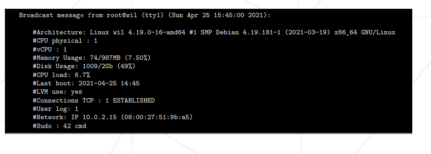
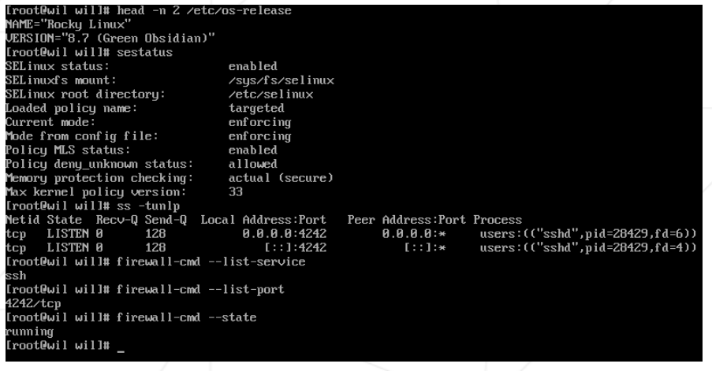
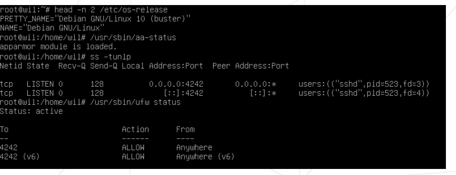
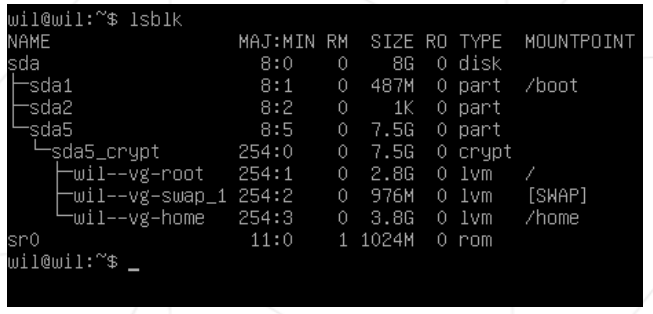
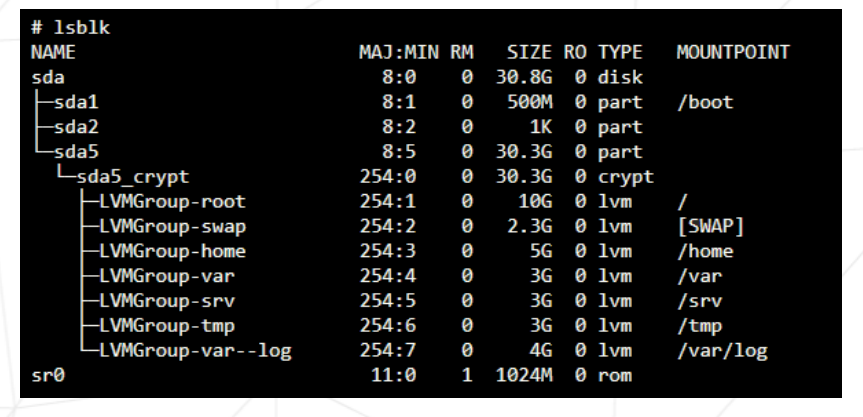

# Born2beroot

## Proje Açıklaması

Bu projede, bir Linux sunucusunun güvenliğini sağlamak ve üzerinde WordPress kurmak için gereken tüm adımlar gerçekleştirilecektir. Parola politikalarından disk bölümlendirmesine, firewall yapılandırmasından bonus servis kurulumlarına kadar tüm süreçler titizlikle ele alınacaktır. Proje sonunda, zorunlu gereksinimler hatasız çalışmalı, bonuslar ise ekstra puan için uygulanabilir olmalıdır.

##  İçindekiler

1. [Giriş](#giriş)
2. [Zorunlu Gereksinimler](#zorunlu-gereksinimler)
3. [Bonus Kısım](#bonus-kısım)
4. [Teslim ve Değerlendirme](#teslim-ve-değerlendirme)
5. [Yol Haritası](#yol-haritası)
6. [Komut Notları](#komut-notları)
7. [Referanslar & Örnekler](#referanslar--örnekler)

##  Giriş

Bu proje kapsamında, sanal bir makine üzerinde güvenlik politikaları uygulanacak, disk bölümlendirmesi ve servis kurulumları gerçekleştirilecektir. Projenin sonunda, sunucunuz hem güvenli hem de işlevsel bir hale gelmiş olacak.

##  Zorunlu Gereksinimler

### Parola Politikası

- Kullanıcı adı parolada geçmemeli.
- Root parolası hariç, yeni parolalar eski paroladan en az 7 karakter farklı olmalı.
- Tüm kullanıcıların ve root'un parolası bu politikaya uygun olarak değiştirilmeli.

### Sudo Yapılandırması

- Sudo ile kimlik doğrulama 3 deneme ile sınırlandırılmalı.
- Yanlış parola girildiğinde özel bir hata mesajı gösterilmeli.
- Her sudo işlemi (girdi/çıktı) `/var/log/sudo/` altında arşivlenmeli.
- TTY modu zorunlu olmalı.
- Sudo ile kullanılabilecek PATH şu şekilde sınırlandırılmalı:
  ```
  /usr/local/sbin:/usr/local/bin:/usr/sbin:/usr/bin:/sbin:/bin:/snap/bin
  ```

### Monitoring Script

- Sunucu açılışında ve her 10 dakikada bir, tüm terminallere aşağıdaki bilgiler `wall` ile yayınlanmalı:
  - Sistem mimarisi ve kernel versiyonu
  - Fiziksel ve sanal işlemci sayısı
  - RAM ve disk kullanımı (yüzde olarak)
  - CPU kullanım yüzdesi
  - Son açılış tarihi/saat
  - LVM aktif mi
  - Aktif bağlantı sayısı
  - Aktif kullanıcı sayısı
  - IPv4 ve MAC adresi
  - Sudo ile çalıştırılan komut sayısı

  

- Script savunmada açıklanmalı ve modifikasyon olmadan durdurulabilmeli (örn. cron kullanımı).

### Firewall & Servis Ayarları

- SSH servisi 4242 portunda çalışmalı.
- Firewalld (Rocky) veya UFW (Debian) ile yalnızca gerekli portlar açık olmalı.
- AppArmor (Debian) veya SELinux (Rocky) aktif olmalı.

  
  

### Disk Bölümlendirme

- LVM ile aşağıdaki gibi bir yapılandırma önerilir:

  

##  Bonus Kısım

**Bonuslar sadece zorunlu kısım %100 tamamlanınca değerlendirilir!**

- Lighttpd, MariaDB ve PHP ile çalışan bir WordPress sitesi kurulmalı.
- NGINX veya Apache2 hariç, kendi seçtiğiniz bir ekstra servis kurulmalı ve savunmada neden seçtiğiniz açıklanmalı.
- Ekstra servisler için gerekli portlar açılmalı ve firewall kuralları güncellenmeli.

  

##  Teslim ve Değerlendirme

- Sadece `signature.txt` dosyası teslim edilmeli. VM dosyası paylaşmak yasak!
- İmza almak için:
  - **Linux:** `sha1sum rocky_serv.vdi`
  - **Windows:** `certUtil -hashfile rocky_serv.vdi sha1`
  - **MacOS/M1:** `shasum rocky_serv.vdi` veya `shasum rocky.utm/Images/disk-0.qcow2`
- Savunmada, `signature.txt` ile VM imzası karşılaştırılacak. Farklıysa notunuz **0**.
- **Snapshot kullanmak kesinlikle yasaktır!** Tespit edilirse notunuz **0** olur.

##  Yol Haritası

1. **Sistem Kurulumu**
    - Temiz kurulum yap, güncellemeleri uygula.
    - LVM ile disk bölümlendirmesini ayarla (örnek görseli takip et).
2. **Güvenlik Politikaları**
    - Parola politikalarını PAM ile uygula.
    - Tüm kullanıcıların ve root'un parolasını değiştir.
3. **Sudo Konfigürasyonu**
    - `/etc/sudoers` veya `sudoers.d` ile gerekli ayarları yap.
    - Özel hata mesajı ve PATH kısıtlamasını ekle.
    - TTY ve loglamayı aktif et.
4. **Monitoring Script**
    - Bash ile monitoring.sh yaz.
    - Cron ile açılışta ve 10 dakikada bir çalışmasını sağla.
    - `wall` ile bilgi paylaşımını uygula.
5. **Firewall ve Servisler**
    - SSH portunu değiştir (4242).
    - UFW veya firewalld ile sadece gerekli portları aç.
    - SELinux/AppArmor etkin olsun.
6. **Bonuslar**
    - Lighttpd + MariaDB + PHP ile WordPress kurulumunu yap.
    - Seçtiğin ekstra servisi kur ve gerekçeni hazırla.
    - Firewall kurallarını güncelle.
7. **Teslim**
    - VM disk imzasını al, `signature.txt` dosyasına ekle.
    - Son bir kontrol ile snapshot olmadığından emin ol.

##  Komut Notları

Kurulum sonrası Linux kullanım notları. Her komut `komut: açıklama` şeklinde, flagler alt maddede.

Komutlar Debian içindir; Rocky farkı olan yerde ayrıca yazılı. Çoğu komut root ya da `sudo` ister.

1. [Sistem bilgisi ve servisler](#1-sistem-bilgisi-ve-servisler)
2. [Kullanıcı ve grup yönetimi](#2-kullanıcı-ve-grup-yönetimi)
3. [Şifre politikası](#3-şifre-politikası)
4. [sudo](#4-sudo)
5. [Hostname](#5-hostname)
6. [SSH](#6-ssh)
7. [UFW (firewall)](#7-ufw-firewall)
8. [AppArmor / SELinux](#8-apparmor--selinux)
9. [cron ve wall](#9-cron-ve-wall)
10. [monitoring.sh](#10-monitoringsh)

### 1. Sistem bilgisi ve servisler

- `uname -a`: çekirdek ve sistem bilgisini yazar.
  - `-a` (all): kernel adı, hostname, sürüm, mimari hepsi birden.
- `cat /etc/os-release`: dağıtım adı ve sürümü (Debian 12 vb.).
- `hostnamectl`: hostname, OS, kernel, sanallaştırma bilgisi.
- `lsblk`: diskleri ve bölümleri ağaç şeklinde gösterir (LVM bölümleri burada görünür).
- `df -h`: dosya sistemlerinin doluluk oranı.
  - `-h` (human-readable): boyutları K/M/G olarak yazar.
- `free -m`: RAM kullanımı.
  - `-m`: değerler MB cinsinden.
- `systemctl status <servis>`: servis çalışıyor mu (ör. `ssh`, `ufw`, `cron`).
- `systemctl start | stop | restart <servis>`: servisi başlat / durdur / yeniden başlat.
- `systemctl enable | disable <servis>`: açılışta otomatik başlasın / başlamasın.
- `sudo reboot`: yeniden başlat. `sudo poweroff`: kapat.
- `apt update`: paket listesini yeniler. `apt install <paket>`: paket kurar. `apt remove <paket>`: kaldırır.
- `dpkg -l | grep <paket>`: paket kurulu mu kontrol.
  - `-l` (list): kurulu paketleri listeler; `grep` istenen satırı süzer.

### 2. Kullanıcı ve grup yönetimi

> **Subject:** senin login'inle bir kullanıcı olacak, `user42` ve `sudo` gruplarında olacak.

- `sudo adduser <kullanıcı>`: yeni kullanıcı oluşturur; home dizini ve şifreyi etkileşimli sorar (Debian).
- `sudo useradd -m <kullanıcı>`: düşük seviye kullanıcı ekleme (Rocky'de `adduser` bunun kısayoludur).
  - `-m`: home dizinini de oluştur.
- `sudo passwd <kullanıcı>`: kullanıcının şifresini değiştirir.
- `sudo deluser <kullanıcı>` / `sudo userdel -r <kullanıcı>`: kullanıcıyı siler.
  - `-r`: home dizinini de sil.
- `sudo groupadd user42`: yeni grup oluşturur.
- `sudo groupdel <grup>`: grubu siler.
- `sudo usermod -aG user42 <kullanıcı>`: kullanıcıyı gruba ekler.
  - `-a` (append): mevcut grupları silmeden ekle. `-a` unutulursa kullanıcı diğer gruplardan çıkar.
  - `-G`: ek (secondary) grup listesi.
- `sudo adduser <kullanıcı> <grup>`: aynı iş, Debian kısayolu.
- `sudo gpasswd -d <kullanıcı> <grup>`: kullanıcıyı gruptan çıkarır.
  - `-d` (delete): üyeliği kaldır.
- `groups <kullanıcı>`: kullanıcının gruplarını listeler.
- `id <kullanıcı>`: uid, gid ve tüm grupları numaralarıyla gösterir.
- `getent group user42`: gruptaki üyeleri gösterir.
- `cut -d: -f1 /etc/passwd`: sistemdeki tüm kullanıcı adları.
  - `-d:`: ayırıcı `:` karakteri. `-f1`: 1. alanı (kullanıcı adı) al.
- `su - <kullanıcı>`: başka kullanıcıya geçer.
  - `-`: o kullanıcının ortamıyla (home, PATH) tam login.
- `whoami`: şu an hangi kullanıcısın.

Grup değişikliği açık oturumda hemen görünmez; çıkış yapıp tekrar gir.

### 3. Şifre politikası

> **Subject:** şifre 30 günde bir dolar, en az 2 gün sonra değişir, 7 gün önceden uyarır; en az 10 karakter, büyük harf + küçük harf + rakam, aynı karakter en fazla 3 kez arka arkaya, kullanıcı adını içermez, eskisinden en az 7 farklı karakter (root için bu son kural geçerli değil), root da kurallara uyar.

#### Süre ayarları: `/etc/login.defs`

Sadece bundan sonra oluşturulan kullanıcılara uygulanır.

```
PASS_MAX_DAYS   30
PASS_MIN_DAYS   2
PASS_WARN_AGE   7
```

- `PASS_MAX_DAYS`: şifrenin geçerli olduğu en uzun süre.
- `PASS_MIN_DAYS`: iki değişiklik arası en az bekleme.
- `PASS_WARN_AGE`: dolmadan kaç gün önce uyarı.

#### Mevcut kullanıcılar için: `chage`

- `sudo chage -l <kullanıcı>`: kullanıcının şifre süre bilgilerini listeler.
  - `-l` (list): sadece göster.
- `sudo chage -M 30 -m 2 -W 7 <kullanıcı>`: ayarları eski kullanıcıya (root ve kendi kullanıcın) uygular.
  - `-M`: max gün. `-m`: min gün. `-W`: uyarı günü.

#### Karmaşıklık kuralları: `libpam-pwquality`

- `sudo apt install libpam-pwquality`: şifre kalite modülünü kurar.
- `sudo nano /etc/pam.d/common-password`: `pam_pwquality.so` satırının sonuna ekle:

```
password requisite pam_pwquality.so retry=3 minlen=10 ucredit=-1 lcredit=-1 dcredit=-1 maxrepeat=3 reject_username difok=7 enforce_for_root
```

- `retry=3`: hatalı girişte 3 deneme hakkı.
- `minlen=10`: en az 10 karakter.
- `ucredit=-1`: en az 1 büyük harf (eksi sayı = "en az bu kadar").
- `lcredit=-1`: en az 1 küçük harf.
- `dcredit=-1`: en az 1 rakam.
- `maxrepeat=3`: aynı karakter en fazla 3 kez arka arkaya.
- `reject_username`: kullanıcı adını içeren şifreyi reddet.
- `difok=7`: eski şifreden en az 7 karakter farklı olmalı. Root eski şifre sorulmadan değiştirdiği için root'ta bu kontrol fiilen çalışmaz.
- `enforce_for_root`: kurallar root için de geçerli.

Ayarlardan sonra mevcut kullanıcıların (root dahil) şifresini `passwd` ile yeni kurallara uygun şekilde değiştir.

### 4. sudo

> **Subject:** 3 deneme hakkı, yanlış şifrede özel mesaj, tüm sudo komutları (girdi ve çıktı) `/var/log/sudo/` altında loglanır, TTY zorunlu, `secure_path` kısıtlı.

- `su -`: root'a geç (sudo henüz kurulu değilken).
- `apt install sudo`: sudo'yu kurar.
- `sudo -V`: kurulu sudo sürümü ve ayarları.
  - `-V` (version): sürüm; root olarak çalışırsa aktif ayarları da yazar.
- `sudo -l`: bu kullanıcının sudo ile neler yapabileceğini listeler.
- `sudo mkdir -p /var/log/sudo`: log klasörünü oluşturur.
  - `-p`: üst klasörler yoksa onları da oluştur, varsa hata verme.
- `sudo visudo -f /etc/sudoers.d/sudo_config`: ayar dosyasını güvenli düzenler.
  - `visudo`: kaydetmeden önce sözdizimi kontrol eder; hatalı dosya sudo'yu kilitlemez.
  - `-f`: hangi dosyanın düzenleneceği.

Dosya içeriği:

```
Defaults  passwd_tries=3
Defaults  badpass_message="Yanlis sifre, tekrar dene."
Defaults  logfile="/var/log/sudo/sudo_config"
Defaults  log_input, log_output
Defaults  iolog_dir="/var/log/sudo"
Defaults  requiretty
Defaults  secure_path="/usr/local/sbin:/usr/local/bin:/usr/sbin:/usr/bin:/sbin:/bin:/snap/bin"
```

- `passwd_tries=3`: şifre için 3 deneme.
- `badpass_message`: yanlış şifrede görünecek mesaj.
- `logfile`: her sudo komutunun yazıldığı log dosyası.
- `log_input, log_output`: komutun klavye girdisini ve ekran çıktısını da kaydet.
- `iolog_dir`: girdi/çıktı kayıtlarının klasörü.
- `requiretty`: sudo sadece gerçek bir terminalden çalışır (scriptten/cron'dan sudo engellenir).
- `secure_path`: sudo komutları sadece bu klasörlerde aranır; sahte PATH ile komut çalıştırmayı engeller.

Kontrol: `sudo cat /var/log/sudo/sudo_config` → son sudo komutları görünmeli.

### 5. Hostname

> **Subject:** hostname = login + `42` (ör. `ayilmaz42`). Savunmada değiştirmen istenebilir.

- `hostname`: mevcut hostname'i yazar.
- `sudo hostnamectl set-hostname <yeni_ad>`: hostname'i kalıcı değiştirir.
- `sudo nano /etc/hosts`: `127.0.1.1  eski_ad` satırını yeni adla güncelle (yoksa sudo "unable to resolve host" uyarısı verir).
- `sudo reboot`: değişikliğin her yerde görünmesi için yeniden başlat.

### 6. SSH

> **Subject:** SSH sadece 4242 portunda çalışır, root ile SSH girişi kapalıdır.

- `sudo apt install openssh-server`: SSH sunucusunu kurar.
- `sudo nano /etc/ssh/sshd_config`: sunucu ayar dosyası. Şu satırların başındaki `#` kaldırılıp düzenlenir:

```
Port 4242
PermitRootLogin no
```

- `Port 4242`: SSH 22 yerine 4242'yi dinler.
- `PermitRootLogin no`: root SSH ile giriş yapamaz.
- Dikkat: `ssh_config` (client) değil, `sshd_config` (server; sondaki **d** = daemon).
- `sudo systemctl restart ssh`: ayarların geçerli olması için yeniden başlat. Rocky'de servis adı `sshd`.
- `sudo systemctl status ssh`: çalışıyor mu ve hangi portu dinliyor.
- `ss -tunlp`: açık portları listeler; 4242 burada görünmeli.
  - `-t` TCP, `-u` UDP, `-n` port numarasını sayı olarak yaz, `-l` sadece dinleyen (listening), `-p` hangi program.
- `ssh <kullanıcı>@localhost -p 4242`: VM içinden bağlantı testi.
  - `-p`: bağlanılacak port.
- `ssh <kullanıcı>@127.0.0.1 -p 4242`: host bilgisayardan bağlanır. Önce VirtualBox → Settings → Network → Advanced → Port Forwarding: Host Port 4242 → Guest Port 4242 kuralı eklenmeli.
- `ssh root@localhost -p 4242`: reddedilmeli (PermitRootLogin testi).
- `exit`: SSH oturumunu kapat.

### 7. UFW (firewall)

> **Subject:** UFW aktif, sadece 4242 açık. Rocky'de UFW yerine `firewalld` kullanılır.

- `sudo apt install ufw`: UFW'yi kurar.
- `sudo ufw enable`: firewall'u açar ve açılışta otomatik başlatır. `sudo ufw disable`: kapatır.
- `sudo ufw default deny incoming`: dışarıdan gelen her şeyi varsayılan olarak engelle.
- `sudo ufw default allow outgoing`: dışarı giden bağlantılara izin ver.
- `sudo ufw allow 4242`: 4242 portuna izin verir (IPv4 ve IPv6 için ayrı kural oluşur).
- `sudo ufw status`: aktif mi ve kurallar.
- `sudo ufw status numbered`: kuralları numaralı listeler.
  - `numbered`: silerken kullanılacak numaraları gösterir.
- `sudo ufw delete <numara>`: o numaralı kuralı siler. Numaralar her silmeden sonra kayar; tekrar `status numbered` bak.
- `sudo ufw allow 8080` → test et → sil: savunmada yeni port açıp silmen istenir.

Rocky (`firewalld`):

- `sudo firewall-cmd --add-port=4242/tcp --permanent`: 4242'yi kalıcı açar.
  - `--permanent`: yeniden başlatmadan sonra da geçerli.
- `sudo firewall-cmd --reload`: kuralları uygular.
- `sudo firewall-cmd --list-all`: açık portlar ve servisler.

### 8. AppArmor / SELinux

> **Subject:** Debian'da AppArmor, Rocky'de SELinux açılışta çalışıyor olmalı.

- `sudo aa-status`: AppArmor yüklü mü, kaç profil enforce / complain modunda.
- `sudo systemctl status apparmor`: servis aktif mi.
- `sestatus`: SELinux durumu (Rocky).
- `getenforce`: SELinux modu: `Enforcing` olmalı.

AppArmor: her programa "hangi dosyalara, portlara erişebilir" profili verir; program ele geçirilse bile profil dışına çıkamaz. Enforce = kuralı uygula, complain = sadece logla.

### 9. cron ve wall

> **Subject:** `monitoring.sh` her 10 dakikada bir tüm terminallere bilgi yazar.

- `sudo crontab -u root -e`: root'un cron tablosunu düzenler.
  - `-u root`: hangi kullanıcının tablosu. `-e` (edit): düzenle.
- `sudo crontab -u root -l`: tabloyu listeler. `-l` (list).
- Eklenecek satır:

```
*/10 * * * * bash /usr/local/bin/monitoring.sh
```

- 5 alan sırasıyla: dakika, saat, ayın günü, ay, haftanın günü. `*/10` = her 10 dakikada bir; `*` = her değer.
- Örnek: `*/1 * * * *` her dakika (savunmada "aralığı değiştir" denebilir).
- `sudo chmod +x /usr/local/bin/monitoring.sh`: scripti çalıştırılabilir yapar.
  - `+x`: execute izni ekle.
- `sudo systemctl stop cron`: scripti, dosyasına dokunmadan durdurur (savunma sorusu). Tekrar: `sudo systemctl start cron`.
- `sudo systemctl disable cron`: açılışta da başlamasın.
- `wall "mesaj"`: mesajı oturum açmış tüm kullanıcıların terminaline yazar (write all).
- `wall -n "mesaj"`: başlık ("Broadcast message from...") olmadan yazar.
  - `-n`: banner'ı gizle; sadece root kullanabilir. Subject'te banner isteğe bağlı.

### 10. monitoring.sh

Script bash ile yazılır, sonuçları `wall` ile yayınlar. Her satırın ne yaptığını savunmada açıklayabilmen gerekir.

```bash
#!/bin/bash
arc=$(uname -a)
pcpu=$(grep "physical id" /proc/cpuinfo | sort -u | wc -l)
vcpu=$(grep -c "^processor" /proc/cpuinfo)
ram=$(free -m | awk '$1 == "Mem:" {printf "%d/%dMB (%.2f%%)", $3, $2, $3*100/$2}')
disk=$(df -BM --total | awk '$1 == "total" {printf "%s/%s (%s)", $3, $2, $5}')
cpul=$(top -bn1 | grep "Cpu(s)" | awk '{printf "%.1f%%", $2 + $4}')
lb=$(who -b | awk '{print $3" "$4}')
lvm=$(if [ $(lsblk | grep -c "lvm") -gt 0 ]; then echo yes; else echo no; fi)
tcp=$(ss -ta | grep -c ESTAB)
ulog=$(users | wc -w)
ip=$(hostname -I | awk '{print $1}')
mac=$(ip link | grep "link/ether" | awk '{print $2}' | head -n1)
sudo=$(journalctl _COMM=sudo | grep -c COMMAND)

wall "#Architecture: $arc
#CPU physical: $pcpu
#vCPU: $vcpu
#Memory Usage: $ram
#Disk Usage: $disk
#CPU load: $cpul
#Last boot: $lb
#LVM use: $lvm
#Connections TCP: $tcp ESTABLISHED
#User log: $ulog
#Network: IP $ip ($mac)
#Sudo: $sudo cmd"
```

Parça parça:

- `uname -a`: mimari ve kernel sürümü.
- `grep "physical id" /proc/cpuinfo | sort -u | wc -l`: fiziksel CPU sayısı.
  - `/proc/cpuinfo`: kernel'in CPU bilgisi. `sort -u`: tekrar eden satırları at (`-u` unique). `wc -l`: satır say.
- `grep -c "^processor" /proc/cpuinfo`: sanal CPU (vCPU) sayısı. Alternatif: `nproc`.
  - `-c` (count): eşleşen satır sayısını yaz. `^`: satır başı.
- `free -m | awk ...`: kullanılan / toplam RAM ve yüzde.
  - `awk '$1 == "Mem:"'`: ilk sütunu `Mem:` olan satırı al. `$2` toplam, `$3` kullanılan. `printf`: biçimli yaz; `%%` = yüzde işareti.
- `df -BM --total`: diskteki kullanılan / toplam alan.
  - `-BM`: blok boyutu MB. `--total`: en alta toplam satırı ekle. `$5`: kullanım yüzdesi.
- `top -bn1 | grep "Cpu(s)"`: CPU yükü.
  - `-b` (batch): etkileşimsiz, düz metin. `-n1`: tek ölçüm al ve çık. `$2` user, `$4` system yüzdesi.
- `who -b`: son açılış (boot) tarihi ve saati. `-b` (boot).
- `lsblk | grep -c "lvm"`: LVM bölümü varsa sayı > 0 → `yes`.
- `ss -ta | grep -c ESTAB`: kurulu (ESTABLISHED) TCP bağlantı sayısı.
  - `-t`: TCP. `-a`: tüm soketler.
- `users | wc -w`: oturum açmış kullanıcı sayısı. `-w`: kelime say.
- `hostname -I`: makinenin IPv4 adres(ler)i. `-I`: tüm IP'ler.
- `ip link | grep "link/ether"`: MAC adresi. `head -n1`: sadece ilk satır.
- `journalctl _COMM=sudo | grep -c COMMAND`: sudo ile çalıştırılan komut sayısı.
  - `journalctl`: systemd logları. `_COMM=sudo`: sadece sudo programının logları.
- `$( ... )`: komutun çıktısını değişkene atar.

Test: `sudo bash /usr/local/bin/monitoring.sh` → çıktı hemen ekranda görünmeli.

##  Referanslar & Örnekler

- [Görsel 1: LVM Disk Yapısı (zorunlu)](#)
  
- [Görsel 2: Monitoring Script Çıktısı](#)
  
- [Görsel 3: Rocky Linux Servisler](#)
  
- [Görsel 4: Debian Servisler](#)
  
- [Görsel 5: Bonus LVM Disk Yapısı](#)
  

---

Bu proje, 42 Okulu müfredatının bir parçasıdır.
